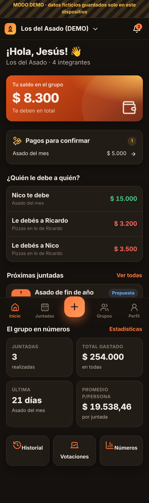
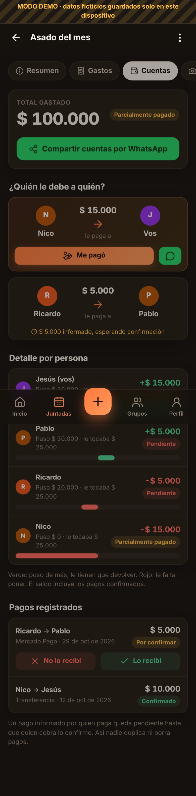
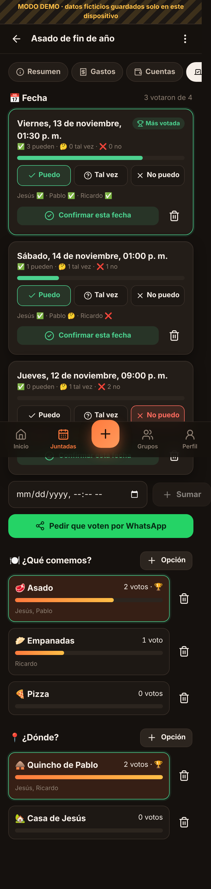
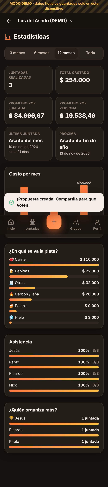

# 🔥 La Juntada

**Organizá asados y juntadas, votá fecha, menú y lugar, cargá lo que pagó cada uno y mirá en tiempo real quién le debe a quién.**

Aplicación web progresiva (PWA) mobile-first, en español de Argentina, con React + Vite + TypeScript y Supabase (Auth, PostgreSQL con RLS, Realtime, Storage, Cron y Edge Functions).

| Inicio | Cuentas | Votación | Estadísticas |
|---|---|---|---|
|  |  |  |  |

---

## Funcionalidades

- **Cuentas y grupos**: registro con email, inicio de sesión, recuperación de contraseña, perfil con nombre, foto y alias de transferencia. Varios grupos por persona, roles admin/miembro, invitaciones por enlace o código (con vencimiento, cupo y anulación), abandonar grupo.
- **Juntadas**: nombre, fecha y hora, lugar, descripción, notas, fotos, lista de invitados (integrantes + invitados externos), confirmación de asistencia, estados *propuesta / confirmada / realizada / cancelada* e historial completo.
- **Gastos compartidos**: descripción, categoría, importe en ARS, fecha, uno o **varios pagadores**, comprobante, observaciones y reparto **en partes iguales, por porcentaje, por montos o por proporciones**, solo entre quienes participaron (el que no tomó cerveza no la paga). Cálculos **exactos al centavo** (enteros + método del mayor resto).
- **Liquidación**: total, lo que puso y lo que le tocaba a cada uno, saldo, **transferencias mínimas sugeridas**, pagos parciales, estados *pendiente / parcialmente pagado / saldado*, confirmación por quien cobra, protección contra pagos duplicados o excesivos.
- **Votaciones** en tiempo real de fecha (*Puedo / Tal vez / No puedo*), menú y lugar, con desempate explicado y confirmación por el organizador.
- **Recordatorios inteligentes** por grupo (7, 15, 30, 45, 60 días o personalizado), sin duplicados, generados por **Supabase Cron** aunque nadie tenga la app abierta; avisos in-app y **Web Push** voluntario.
- **WhatsApp**: botones con enlaces oficiales `wa.me` para propuestas, cuentas, confirmaciones, invitaciones y recordatorios de deuda.
- **Dashboard y estadísticas**: juntadas realizadas, total gastado, promedios, última/próxima juntada, días sin juntarse, organizadores, asistencia, gasto por mes y por categoría, filtros por período.
- **PWA**: instalable en Android e iPhone, funciona sin conexión en modo lectura con los últimos datos, actualización controlada.
- **Modo demo**: datos ficticios claramente marcados, guardados solo en el navegador, para probar todo sin registrarse (se puede abrir otra pestaña con otro amigo y ver la sincronización).
- Modo oscuro y claro.

## Estructura

```
├── src/
│   ├── lib/            # Lógica pura: dinero, saldos, votaciones, recordatorios, estadísticas (+ tests)
│   ├── data/           # Backend Supabase y backend demo (misma interfaz y mismas reglas)
│   ├── app/            # Contexto, sesión, sincronización en tiempo real y caché offline
│   ├── components/     # UI reutilizable, gráficos, PWA
│   ├── pages/          # Pantallas
│   └── sw.ts           # Service Worker (precache + push)
├── supabase/
│   ├── migrations/     # Migraciones SQL versionadas
│   ├── functions/      # Edge Function send-reminders (Web Push)
│   ├── tests/          # Pruebas de RLS y reglas de negocio en PostgreSQL real
│   └── cron_push.sql   # Programación del envío push (se corre una vez)
├── tests/e2e/          # Prueba de punta a punta con Playwright (modo demo)
├── docs/               # Documentación técnica, guía de uso, informe de pruebas
└── .github/workflows/  # CI, GitHub Pages y Cloudflare Pages
```

## Desarrollo local

```bash
npm install
npm run dev          # http://localhost:5173 (sin .env.local arranca en modo demo)
npm test             # pruebas unitarias (cálculos financieros, votos, recordatorios)
npm run test:db      # migraciones + RLS + RPC en un PostgreSQL temporal (requiere PostgreSQL 15+)
npm run build        # build de producción en dist/
npm run test:e2e     # e2e (requiere `npx vite preview --port 4173` corriendo y Playwright)
```

## Puesta en marcha con Supabase (gratis)

1. Creá un proyecto en [supabase.com](https://supabase.com) (plan Free).
2. Aplicá las migraciones, con la CLI:
   ```bash
   npx supabase login
   npx supabase link --project-ref TU_PROJECT_REF
   npx supabase db push
   ```
   o pegando en el **SQL Editor**, en orden, los archivos de `supabase/migrations/`.
3. **Authentication → URL Configuration**: *Site URL* = la URL pública de la app (por ejemplo `https://jesusriossantander-png.github.io/Juntadas/`) y agregala en *Redirect URLs*.
4. Copiá **Project URL** y **anon public key** (Settings → API). Son públicas; la `service_role` **nunca** va en el frontend.
   - Local: creá `.env.local` a partir de `.env.example`.
   - Producción: cargalas como *secrets* del repo en GitHub (`VITE_SUPABASE_URL`, `VITE_SUPABASE_ANON_KEY`).
5. (Opcional) **Web Push y recordatorios por push**:
   ```bash
   npx web-push generate-vapid-keys
   npx supabase secrets set VAPID_PUBLIC_KEY=... VAPID_PRIVATE_KEY=... VAPID_SUBJECT=mailto:vos@email.com CRON_SECRET=$(openssl rand -hex 24)
   npx supabase functions deploy send-reminders --no-verify-jwt
   ```
   Habilitá las extensiones `pg_cron` y `pg_net`, editá y ejecutá `supabase/cron_push.sql` en el SQL Editor y cargá `VITE_VAPID_PUBLIC_KEY` como secret del repo.
   Los recordatorios **in-app** funcionan sin esto: la migración `0005` programa `generate_due_reminders()` todos los días a las 10:00 (hora argentina) si `pg_cron` está habilitado.

## Publicación

- **GitHub Pages (gratis)**: el workflow `deploy-pages.yml` publica en cada push a `main`. Una sola vez: *Settings → Pages → Source: GitHub Actions*. URL: `https://<usuario>.github.io/<repo>/`.
- **Cloudflare Pages (gratis)**: el workflow `deploy-cloudflare.yml` publica si cargás los secrets `CLOUDFLARE_API_TOKEN` (permiso *Cloudflare Pages: Edit*) y `CLOUDFLARE_ACCOUNT_ID`. También podés conectar el repo desde el panel de Cloudflare: build `npm run build`, salida `dist`, variables `VITE_*`.
- Sin variables de Supabase, la app publicada funciona en **modo demo**.

## Instalación en el celular

- **Android**: abrí la URL en Chrome → *Instalar app* (o menú ⋮ → *Agregar a pantalla principal*).
- **iPhone**: abrí la URL en **Safari** → Compartir → *Agregar a inicio*. Las notificaciones push requieren iOS 16.4+ y la app instalada.

## Documentación

- [Documentación técnica](docs/TECNICO.md) — arquitectura, modelo de datos, seguridad, decisiones.
- [Guía de uso](docs/GUIA-DE-USO.md)
- [Informe de pruebas y pendientes](docs/INFORME-DE-PRUEBAS.md)
